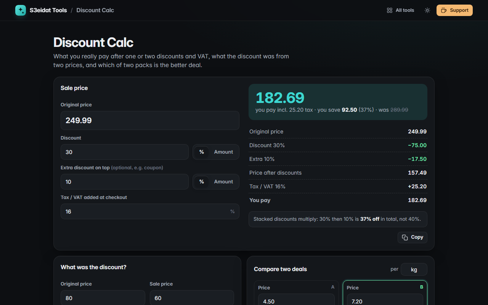

# Discount Calc

> Sale price, savings and tax in one place, plus reverse discounts and unit-price comparison. Free, private, and it runs entirely in your browser.

### ▶ [Open Discount Calc](https://s3eidat.github.io/discount-calc/)



## Features

- **Sale price** from a percent **or** fixed-amount discount
- **Stacked second discount** (coupon on top of a sale), with the true combined discount: 20% then 10% is 28% off, not 30%
- **Tax / VAT** added after discounts, with a clear receipt-style breakdown
- **What was the discount?** Find the percent from the original and sale price (and spot price increases)
- **Compare two deals** by unit price (per kg, per litre, per piece…) and see which is cheaper and by how much
- Money handled in whole cents and rounded like a till; copy a summary; inputs remembered on this device

## Privacy

Your numbers never leave your device. There is no server, no account, no analytics.
The page ships with a strict Content-Security-Policy (`connect-src 'self'`), so the browser
itself blocks any attempt to send data anywhere.

## Run it yourself

It's plain HTML, CSS and JavaScript with no build step:

```bash
git clone https://github.com/s3eidat/discount-calc
cd discount-calc
python -m http.server 8000
```

Then open http://localhost:8000.

## Support

If this saved you time, **[buy me a coffee ☕](https://s3eidat.github.io/coffee/)**. It keeps every tool free.

---

Part of **[S3eidat Tools](https://s3eidat.github.io/)**: 100+ free, private tools that run in your browser. MIT licensed.
